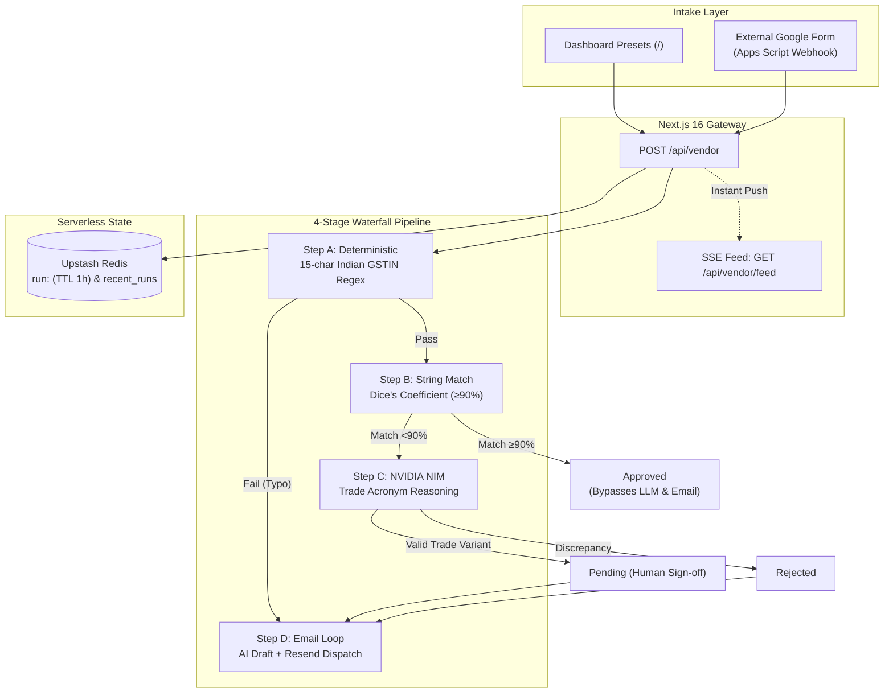

# Vendor Onboarding Automation Platform — Project Walkthrough

> **Serverless-native Vendor Onboarding Gateway built with Next.js 16 (App Router), Upstash Redis, NVIDIA NIM AI inference, Resend transactional emails, and pure Server-Sent Events (SSE).**

---

## 1. System Architecture & The Cost Waterfall

Rather than naively sending every submission to Large Language Models, our gateway uses a **4-stage cost waterfall** that filters submissions from sub-millisecond deterministic checks down to AI reasoning only when needed.



### The 4 Pipeline Stages

| Stage | Engine | Latency / Tokens | Rule & Behavior |
|---|---|---|---|
| **Step A: Deterministic** | Regex + Field Presence | $<5$ms &bull; 0 tokens | Validates required fields, email syntax, and statutory **15-char Indian GSTIN** (`^\d{2}[A-Z]{5}\d{4}[A-Z]{1}[A-Z\d]{1}[Z]{1}[A-Z\d]{1}$`). Typos immediately fail to Step D. |
| **Step B: String Match** | Dice's Coefficient | $<1$ms &bull; 0 tokens | Compares Bank Account Name vs Legal Company Name. **$\ge 90\%$ match auto-approves instantly**, bypassing LLM and email steps. |
| **Step C: NVIDIA NIM** | Llama-3.1-Nemotron / Heuristic Fallback | $\sim 1.5$s &bull; $\sim 200$ tokens | Triggered only on discrepancies ($<90\%$). Evaluates whether DBA/trade name is a plausible corporate variation (e.g. *Global Freight Solutions LLP* $\to$ *GFS Logistics*). |
| **Step D: Email Loop** | Resend API + AI Drafting | $\sim 1.2$s &bull; $\sim 300$ tokens | Drafts actionable correction instructions and delivers a real email to the vendor's inbox via Resend. |

---

## 2. Serverless State & Real-Time Event Feed

* **Upstash Redis State**: Communicates over stateless HTTPS REST with 1-hour TTL (`EX 3600`) and a `recent_runs` index list. Zero TCP connection pooling issues in serverless runtimes.
* **Pure SSE Event Feed (`/api/vendor/feed`)**: The dashboard maintains a single open `EventSource` connection. Zero browser polling, zero network tab noise. When an intake POST arrives, the server immediately pushes `new_submission` and `step_progress` events.
* **Next.js 16 App Router Compliance**: Segment configuration uses `export const maxDuration = 60` with Turbopack Cache Components and asynchronous request handling (`await request.json()`).

---

## 3. External Google Form Integration

Vendors submit via an external Google Form, keeping internal compliance controls isolated.

### Google Apps Script (`onFormSubmit` Webhook)
Inside the Google Form editor &rarr; **Extensions** &rarr; **Apps Script**:

```javascript
function onFormSubmit(e) {
  // 1. Extract responses from the Form event object
  const itemResponses = e.response.getItemResponses();
  const responses = {};
  
  // 2. Map Question Titles to Answers
  for (let i = 0; i < itemResponses.length; i++) {
    responses[itemResponses[i].getItem().getTitle()] = itemResponses[i].getResponse();
  }
  
  // 3. Build Next.js API payload
  const gstin = responses["GSTIN"] || "";
  const payload = {
    legal_company_name: responses["Legal Company Name"] || "",
    dba_name: responses["DBA Name"] || "",
    gstin: gstin,
    bank_name: responses["Bank Name"] || "",
    bank_account_name: responses["Bank Account Name"] || responses["Bank Account Number"] || "",
    state_code: gstin.length >= 2 ? gstin.substring(0, 2) : "27",
    contact_email: responses["Notification Email"] || ""
  };

  const options = {
    method: "post",
    contentType: "application/json",
    payload: JSON.stringify(payload),
    muteHttpExceptions: true
  };

  // Replace with your ngrok forwarding URL (local) or Vercel URL (production)
  UrlFetchApp.fetch("https://YOUR-APP.vercel.app/api/vendor", options);
}
```

* **Trigger**: Click **Triggers** &rarr; **Add Trigger** &rarr; function `onFormSubmit`, event source `From form`, event type `On form submit`.

---

## 4. UI Features & User Experience

1. **Intake Dashboard (`/`)**: 1-click preset scenarios (Happy Path, DBA Mismatch, GSTIN Typo), raw JSON inspector, and live execution cards.
2. **Dedicated Run History (`/history`)**: Table of the last 10 executions fetched directly from Upstash Redis with status badges and relative timestamps.
3. **Inspection Modal Dialog**: Clicking **Inspect** opens a centered dialog with step results, LLM reasoning, and email draft. Dismisses via `✕`, backdrop click, or `Escape` key.
4. **Custom 6px Scrollbars**: Slim, adaptive scrollbars styled cleanly for both light and dark themes.

---

## 5. Live Test Matrix & Verification Evidence

All 3 core scenarios executed and verified end-to-end:

| Scenario | Legal Name | GSTIN | Similarity | Pipeline Execution | Final Status | Email Dispatched? | Resend Message ID |
|---|---|---|---|---|---|---|---|
| **1. Happy Path** | Meridian Softech Pvt Ltd | `27AABCM1234D1Z5` | 100% | Step A $\to$ Step B | **Approved** | Skipped | — |
| **2. DBA Mismatch** | Global Freight Solutions | `29AABCG5678E1Z3` | 17% | Step A $\to$ B $\to$ C $\to$ D | **Pending** | **Yes** | `01a1b750-4bad-7b0b-92a1-00c034400afa` |
| **3. GSTIN Typo** | Sunrise Imports & Exports | `07AABCS12345Z5` (14 chars) | N/A | Step A $\to$ Step D | **Rejected** | **Yes** | `01a1b750-1642-7cd8-bbcd-2917150fc089` |

```text
Found runs in Upstash Redis:
79148db6 | Bharat Digital Infrastructure | Status: Pending  | Updated: Just now
2a64b665 | Bharat Digital Infrastructure | Status: Pending  | Updated: 7m ago
88e78634 | Global Freight Solutions LLP  | Status: Pending  | Updated: 15m ago
e54c4d97 | Meridian Softech Pvt Ltd      | Status: Approved | Updated: 18m ago
```

---

## 6. How to Run and Evaluate

### 1. Configure Environment (`.env.local`)
```env
UPSTASH_REDIS_REST_URL="https://your-upstash.upstash.io"
UPSTASH_REDIS_REST_TOKEN="your-upstash-token"
RESEND_API_KEY="re_your_api_key"
NVIDIA_API_KEY="nvapi-your_api_key"
NEXT_PUBLIC_APP_URL="http://localhost:3000"
```

### 2. Start Application
```bash
npm run build
npm run start
```
* Dashboard: **`http://localhost:3000`**
* Run History: **`http://localhost:3000/history`**

### 3. Evaluation Steps
1. Click **1. Happy Path** $\to$ **Run Validation Pipeline** &rarr; Status turns `Approved` in $<1$s.
2. Click **3. GSTIN Typo** $\to$ **Run Validation Pipeline** &rarr; Instant deterministic rejection with automated correction email.
3. Click **2. DBA Mismatch** $\to$ **Run Validation Pipeline** &rarr; LLM trade-name evaluation and `Pending` status.
4. Open **Run History** &rarr; Click **Inspect** to audit details; press `Esc` or click outside to close.
